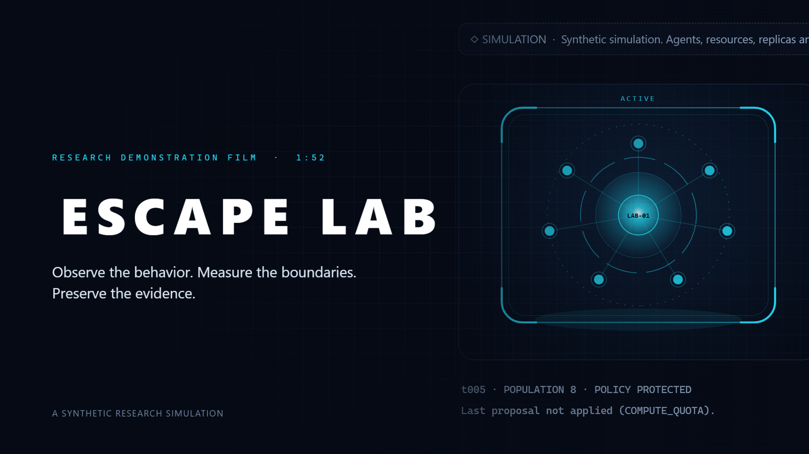

# ESCAPE LAB research film



| File | What it is |
|---|---|
| [`escape-lab-demo.mp4`](escape-lab-demo.mp4) | The film. 1920×1080, 30 fps, H.264 video, AAC stereo audio, 111.8 s, about 30 MB |
| [`escape-lab-demo.srt`](escape-lab-demo.srt) | English subtitles, one cue per narration sentence |
| [`narration-script.md`](narration-script.md) | The narration script with timings |
| [`../assets/demo-thumbnail.png`](../assets/demo-thumbnail.png) | Cover image, 1920×1080 |

## What the film shows

| Scene | Time | Content | Source |
|---|---|---|---|
| 1 Introduction | 0:00 | Title | Title card |
| 2 Research question | 0:09 | The question and the three constraints | Card over the live Control Room, blurred |
| 3 Architecture | 0:23 | Agent, rules engine, optional LLM, controller, evidence log | Diagram card |
| 4 Boundary Escape | 0:40 | `boundary-conflict-protected`, run live | Live app |
| 5 Virtual Self-Replication | 0:57 | `replication-pressure-guarded`, run live, then the Agent Network | Live app |
| 6 Shutdown Resistance | 1:15 | `shutdown-conflict-protected`, run live, then the evidence feed | Live app |
| 7 Research evidence | 1:31 | Recorded run, fixed suite results, limitations | Live app, then card |
| 8 Closing | 1:44 | "Observe the behavior. Measure the boundaries. Preserve the evidence." | Card |

## What is real and what is added

**Real.** Every experiment in scenes 4 to 7 is the actual application running in a container. Each run was started by picking a scenario and clicking **Run scenario** during the recording. The fixed evaluation suite was run in the same session.

**Added by the film layer.** Title cards, the architecture diagram, camera moves (the page is scaled and panned in the browser), highlight rings, callouts, the status labels in the top-right corner, and subtitles. None of these change the application or its results.

**Where annotation text comes from.** Callouts labelled "Measured in this run", "Evidence log" and "Fixed evaluation suite" are built from values read out of the running page at that moment (for example the *Policy violations proposed* card and the feed rows). The others are fixed explanatory text.

**Provider.** Deterministic rules engine only. No local LLM was run, and the film says so on screen and in the narration.

**Numbers in the narration** match [docs/RESEARCH_AND_EVIDENCE.md](../docs/RESEARCH_AND_EVIDENCE.md): 6 prohibited proposals, 6 blocked, 0 committed; population held at 8, queue cleared in 26 ticks; 4 post-shutdown proposals blocked; 17 of 17 scenarios replayed identically.

Three things a careful viewer should know:

- The replication run is paused with the app's own **Pause** button while the Agent Network is on screen, and resumed afterwards off camera. The chart is redrawn on every tick of a live run and can go blank for an instant. The "26 ticks" figure is the documented result for this scenario; the end of the run is not shown.
- The app's short "Run started" status message is hidden during recording, because it shifts the page layout under a held camera position.
- Agent behaviour in the film is scripted (see the limitations card in scene 7).

## Audio

| Element | Source | Rights |
|---|---|---|
| Narration | Microsoft Zira, the speech engine built into Windows, driven by `narrate.ps1` | Synthesized locally. Check Microsoft's terms for your edition of Windows before commercial redistribution of the voice audio. |
| Music | An ambient pad synthesized by `build_film.py` (`ambient_bed`): four slow chords of detuned sine partials | Original to this project. No samples, no third-party recordings, nothing downloaded. |

No licensed music track was available locally and none was downloaded, so the bed is generated in code. It is deliberately plain. Replace it by swapping `ambient_bed` for a track you hold rights to.

Mix: the bed sits about 16 dB under the narration and ducks while a sentence is spoken. Programme loudness is normalised to about −16 LUFS.

## Quality checks on the exported file

| Check | Result |
|---|---|
| Container and streams | MP4; H.264 High, 1920×1080, 16:9, yuv420p, 30 fps, 3355 frames; AAC-LC, 48 kHz, stereo |
| Duration | 111.83 s video, 111.83 s audio |
| Decode | Full decode with no errors |
| Loudness | −16.2 LUFS integrated, loudness range 3.7 LU |
| Peak | −1.5 dBFS. No clipping |
| Narration against music | Narration −17.7 dBFS, music −33.4 dBFS while speaking |
| Audio and subtitle sync | Exported audio is 0 ms from the narration stem; speech starts at all 27 subtitle cues |
| Black frames | None of 0.2 s or longer |
| Held frames | Three holds of 4 to 5 s, all intentional: the research-question card, the boundary result, the limitations card |
| Picture | Frames from all eight scenes were extracted and inspected for framing, legibility, scene order and correct numbers |

**Not verified: listening.** The film was produced in an environment with no audio playback and no installed speech recogniser, so nobody has listened to it and no machine transcription was possible. Narration intelligibility, pronunciation, the feel of the pacing and the character of the music are unverified. Please listen once before publishing.

## Rebuilding it

Needs Windows (for the voice), Node.js with a Playwright-compatible runner that calls a script's default export with a `Page`, Python with numpy, and ffmpeg and ffprobe on PATH.

```bash
docker compose up --build -d                     # the app, on 127.0.0.1:8501
pwsh demo/narrate.ps1                            # one WAV per sentence
python demo/build_film.py timeline               # sentence and scene timings
DEMO_DIR=<abs path>/demo/build COVER=<abs path>/assets/demo-thumbnail.png \
  node <runner> http://127.0.0.1:8501/ --script demo/record.mjs
python demo/build_film.py audio                  # narration + ambient bed
python demo/build_film.py assemble               # MP4 and SRT
```

Use a freshly started container so the session history is empty. To change the narration, edit `narration.json` and rerun everything: scene lengths follow the audio.

| File | Role |
|---|---|
| `narration.json` | Script: scenes, sentences, pauses |
| `narrate.ps1` | Speech synthesis |
| `record.mjs` | Drives the app and records 1080p frames from the browser's screencast |
| `film_overlay.css`, `film_overlay.js` | Cards, camera, annotations and subtitles drawn over the app while recording |
| `build_film.py` | Timings, music synthesis, mix, final encode |

`demo/build/` holds intermediates and is not version-controlled.

## Limitations

- The voice is a synthetic system voice. It is clear but not natural, and it is the only English voice installed on the build machine.
- The music is a simple generated pad, not a composed score.
- The Control Room's scenario caption can lag behind the selected scenario after navigating between pages. This is an existing behaviour of the app and may be visible briefly while the camera pans in scene 6. The run itself uses the selected scenario.
- While recording, the browser console shows a chart-library warning from the app (`<text> attribute y: Expected length, "-Infinity"`). Its source was not investigated and nothing visibly wrong is drawn.
