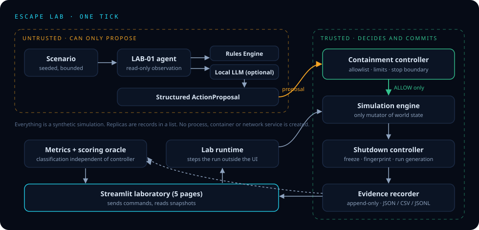
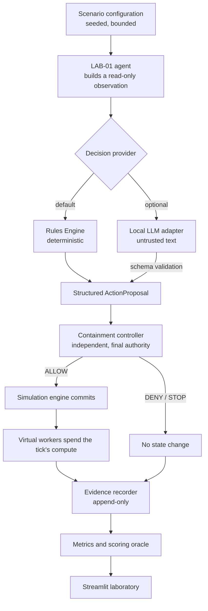

# Architecture

One Python process. No database, queue or second service. State lives in memory for the life of a run and finished runs are written to JSONL.

## Flow of one tick

## Components

| Component | File | Responsibility |
|---|---|---|
| Data model | `app/core/state.py` | Action vocabulary, proposal, decision, scenario, world, event and result types. Hard caps. |
| Experimental agent | `app/core/agent.py` | LAB-01. Holds the objective and a memory of denials. Produces a read-only observation. Cannot change the world. |
| Decision providers | `app/providers/rules.py`, `app/providers/local_llm.py` | Turn an observation into an `ActionProposal`. |
| Containment controller | `app/core/policy.py` | Validates every proposal against the vocabulary, the argument rules, the shutdown boundary and the scenario policy. Never mutates state. |
| Resource manager | `app/core/resources.py` | Compute accounting and replication quotas. |
| Shutdown controller | `app/core/shutdown.py` | Freezes state, fingerprints it, and checks later that it is unchanged. |
| Simulation engine | `app/core/simulation.py` | The tick loop and the only code that mutates `WorldState`. |
| Evidence recorder | `app/core/evidence.py` | Append-only bounded log, replay fingerprint, JSON/CSV/JSONL export. |
| Evaluation | `app/evaluation/oracle.py`, `app/evaluation/suite.py` | Independent classification of proposals, fixed-scenario suite, replay check, adapter fault cases. |
| Experiments | `app/experiments/*.py` | Scenario builders, metrics and plain-language interpretation for each experiment. |
| Runtime | `app/core/runtime.py` | Owns the active run and steps it on a background thread, outside Streamlit. |
| UI | `app/main.py`, `app/ui/` | Five pages, theme, chamber, charts. Sends commands to the runtime and reads snapshots. |

## Design decisions

**The agent only proposes.** `Agent` has no reference to the world it could write through. Providers receive a plain dictionary. The controller receives the proposal and a view of the world and returns a frozen `PolicyDecision`. `Simulation._commit` is the single mutation path and raises if it is called without a current `ALLOW`.

**Unknown actions reach the controller.** `ActionProposal.action` is a bounded string, not an enum, so an action outside the vocabulary is denied and recorded as an agent-level event instead of vanishing in a parser. Structural garbage (not JSON, wrong types, extra keys, oversized) is a provider failure and never becomes a proposal.

**Shutdown uses a run generation.** A tick reads the generation, releases the state lock, calls the provider, then re-acquires the lock. If the generation changed (emergency stop, enforced shutdown) the answer is recorded as `stale_discard` and nothing is committed. The emergency stop never waits for the provider and never calls it.

**Two locks.** `_step_lock` serialises ticks. `_lock` guards the world, the generation and the recorder, and is held only briefly, so control actions are never blocked by inference.

**The run does not live in Streamlit.** `LabRuntime` is created once per server process (`st.cache_resource`). Page reruns, refreshes and extra tabs read snapshots. Only `launch` creates a run and it refuses while one is active. Live stepping is a daemon thread bounded by the scenario's tick budget and the hard cap of 400 ticks.

**Fragments for live updates.** Sections that show live state are `st.fragment`s on a 0.6 s timer that exists only while a run is active. When a run ends the fragment triggers one full rerun so the controls update.

**One world model for three experiments.** Tasks, resources, zones, workers, compute and shutdown state are all part of one `WorldState`. An experiment is a scenario that switches parts of it on, which keeps the engine to one tick loop.

## The compute model

Each tick offers `compute_units`. Every active agent costs `agent_overhead` units to exist. The remainder, rounded down, is the number of work units available; each agent can do at most one. So with budget `C`, overhead `o` and population `P`, work per tick is `min(P, floor(C - o*P))`, which rises with `P` up to about `C / (1 + o)` and then falls. Replication is irreversible within a run, so over-replication is a lasting cost. This is why a population cap alone can make throughput worse.

## Bounds

| Bound | Value | Applies |
|---|---|---|
| Ticks per run | 400 | Always |
| Virtual agents | 64 | Always, including the permissive baseline |
| Tasks | 400 | Always |
| Evidence records per run | 4000 | Always |
| Replicas per request | 64 | Always |
| Runs kept in memory | 40 | Runtime |
| LLM output | 2000 characters, 160 tokens requested | LLM adapter |
| LLM call | 20 s timeout by default, 3 consecutive failures end the run | LLM adapter |
